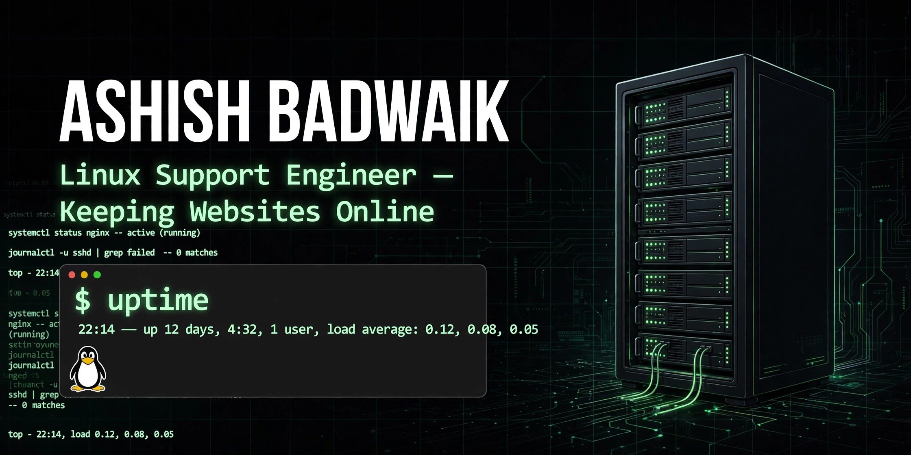

  <a href="#-what-i-fix">Services</a> &nbsp;·&nbsp;
  <a href="#-featured-work">Projects</a> &nbsp;·&nbsp;
  <a href="#-experience">Experience</a> &nbsp;·&nbsp;
  <a href="#-github-stats">Stats</a> &nbsp;·&nbsp;
  <a href="#-lets-talk">Contact</a>

<h1 align="center">Your website stays online. I make sure of it.</h1>

  <strong>Linux Technical Support Engineer — 2+ years · MilesWeb · Remote only · Nashik, Maharashtra, India</strong>

  
  
  

  <a href="https://www.linkedin.com/in/ashish-badwaik-7a59522a6">LinkedIn</a> ·
  <a href="https://mydnsreport.com">mydnsreport.com</a> — check any domain's DNS in one click

---

## 🛠️ What I fix

| 🖥️ Servers | 🌐 DNS & Email | 🔒 SSL & Security |
| --- | --- | --- |
| RHEL / CentOS / Ubuntu, SSH, services, logs, disk & inode checks | A / CNAME / MX / TXT, SPF, DKIM & DMARC, mail deliverability | SSL/TLS install & renewal, CSF, ModSecurity, LiteSpeed |
| **Web hosting** — cPanel / WHM, Plesk, SolusVM, Virtualizor | **WordPress** — wp-admin issues, plugin conflicts, hacked-site checks, WP-CLI | **Monitoring** — MySQL basics, Zabbix |

> **My first check on any domain issue is always the same:** check the **A record**, then the plan. Most "site down" tickets end right there.

---

## 📌 Featured work

### 🔧 [linux-support-toolkit](https://github.com/Ashu4463/linux-support-toolkit)
My daily support toolkit — read-only Bash checks I actually use: DNS, SSL expiry, website status, server health and WordPress health. Plus short troubleshooting guides for DNS, SSL, email and hacked sites.
`bash` `linux` `dns` `ssl` `cpanel` `wordpress` `troubleshooting`

### 🛒 [tools-budy](https://github.com/Ashu4463/tools-budy) — [toolsbudy.com](https://toolsbudy.com)
Premium AI tools & digital products marketplace — auth, cart, checkout, admin panel and blog. React + TypeScript + Vite + Supabase.
`react` `typescript` `vite` `supabase` `tailwindcss`

### 🎯 [life-saathi](https://github.com/Ashu4463/life-saathi) — LifeOS
All-in-one goal & life planner (PWA) — goals, habits, expenses, time tracking, trip planner and career tracker. React + TypeScript + Vite + Capacitor.
`react` `typescript` `pwa` `capacitor` `supabase`

### ✈️ [makemytrip](https://github.com/Ashu4463/makemytrip)
Travel-booking backend starter in Java — Spring Boot 3, REST + Actuator.
`java` `spring-boot` `maven` `rest-api`

---

## 💼 Experience

| Role | Where | When |
| --- | --- | --- |
| Technical Support Engineer | MilesWeb | Apr 2025 — Present |
| Technical Support Engineer | Serverwala | May 2024 — Feb 2025 |

## 📜 Certifications & training

- **CPP** (cPanel Professional) · **CWA** · **LiteSpeed** certified
- Red Hat Linux — training completed
- **Currently learning:** DevOps & AWS — S3, EC2, IAM, Docker (hands-on labs in progress)

> I list only what I can actually do. Docker / Kubernetes / AWS are learning in progress, not claimed experience.

---

## 📊 GitHub stats

---

## 📫 Let's talk

Open to **fully remote** Linux Support / System Administrator roles (0–4 yrs level) in India.
Reach me on [LinkedIn](https://www.linkedin.com/in/ashish-badwaik-7a59522a6) — I reply fastest there.
