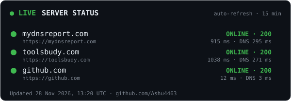

# Hi, I'm Ashish 👋

**Linux Support Engineer — I keep websites online.**
2+ years · MilesWeb · Remote only · Nashik, Maharashtra, India

🌐 Built **[mydnsreport.com](https://mydnsreport.com)** — check any domain's DNS records in one click.

  
  
  

The card above is live — a GitHub Action checks my sites every 15 minutes and redraws it. Green means I'm doing my job. 🙂

---

## 🔧 What I do

- **Linux servers** — RHEL / CentOS / Ubuntu, SSH, services, logs, disk & inode checks
- **Web hosting** — cPanel / WHM, Plesk, SolusVM, Virtualizor
- **DNS & email** — A / CNAME / MX / TXT, SPF, DKIM & DMARC, mail deliverability
- **SSL & security** — SSL/TLS install & renewal, CSF, ModSecurity, LiteSpeed
- **WordPress** — wp-admin issues, plugin conflicts, hacked-site checks, WP-CLI

> My first check on any domain issue is always the same: check the **A record**, then the plan. Most "site down" tickets end right there.

---

## 📌 Featured

---

## 💼 Experience

| Role | Where | When |
| --- | --- | --- |
| Technical Support Engineer | MilesWeb | Apr 2025 — Present |
| Technical Support Engineer | Serverwala | May 2024 — Feb 2025 |

**Certs:** CPP (cPanel Professional) · CWA · LiteSpeed — Red Hat Linux training completed.
**Learning:** DevOps & AWS (S3, EC2, IAM, Docker — hands-on labs in progress, not claimed experience).

---

## 📊 GitHub stats

---

## 📫 Let's talk

Open to **fully remote** Linux Support / System Administrator roles (0–4 yrs level) in India.
Reach me on [LinkedIn](https://www.linkedin.com/in/ashish-badwaik-7a59522a6) — I reply fastest there.
